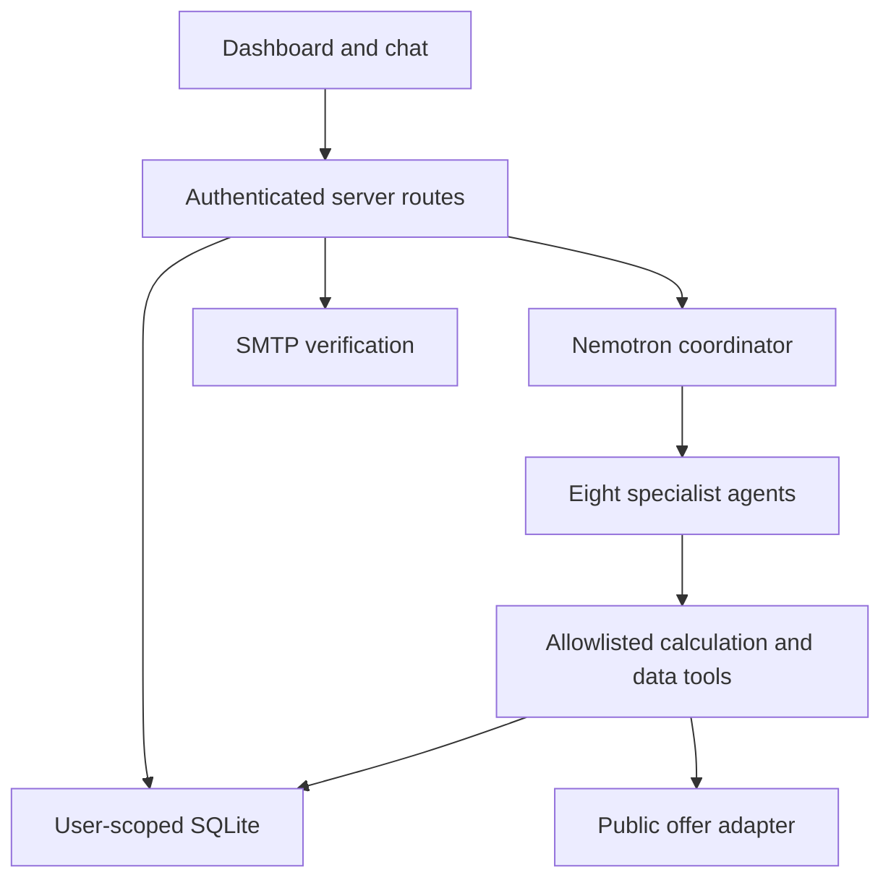

# Architecture and ownership

One TypeScript Next.js App Router application; React UI; Node server routes; SQLite with parameterized queries; Node crypto password verification; SMTP delivery; server-side Nemotron HTTP adapter. Use existing hosting only if it supports persistent data. No microservices or heavy agent framework needed.

Lane A owns src/app pages and src/components. Lane B owns src/server/auth, src/server/db, src/server/tools/finance, simulator and routes. Lane C owns src/server/agents, src/server/nemotron, offer adapter, run orchestration. C requests data through B's authenticated tool layer, not raw cross-user DB queries.

## Data flow

The session establishes user identity server-side. Simulator connections authorize selected accounts. Tools select only authorized accounts for that user. Aggregate 30 months in SQL; send minimal summaries and selected evidence to Nemotron, not every transaction. LLM requests tools; server validates arguments, ownership and policy before execution. Persist agent steps, tool calls, findings and plan versions. Evidence gate verifies referenced IDs and calculated numbers. User confirmation is a server action, not a model-generated permission.

## Agent runtime

A shared runAgent(role, messages, allowlistedTools, context) loop supports each distinct role prompt. Bound each specialist to 4 tool rounds, 1 malformed-output repair, 30-second request timeout and 90-second specialist timeout. Initial global budget: 24 inference calls per checkup with concurrency 2; enforce budget server-side and allow partial results. Tune after real latency measurement. Coordinator uses a constrained routing result, then server executes a dependency DAG; no arbitrary self-spawn. Never reveal hidden model reasoning; display concise decisions and actual tool events.

First data integrity → then cash/subscriptions/debt tools; deal scout depends on subscriptions; goal allocator depends on cash/debt/confirmed subscription options; stress tests depend on candidate plans. Plan repair runs on an explicit changed-data event, not every chat message. Full checkup executes relevant roles; skipped roles must say why. Chat uses the same adapter but has its own read/request-run tool allowlist.

## External integration

Real Nemotron inference is required. SMTP sends actual local SMTP messages into Mailpit during development. A live offer adapter fetches allowlisted provider pages and records retrieval status/provenance; fixtures are separate. Public sources may block requests. No fictional API success and no claim of live bank integration. Confirm with the sponsor whether the chosen public source integration satisfies their external tools criterion; keep the tool trace available.

## Reliability

Idempotency keys for link/sync, checkup submission, events and plan acceptance. Snapshot version per run; cancel or mark stale when connections/data change. Run failure must not silently replace an accepted plan. SSE may be added after polling works; polling every 2 seconds while a run is active is sufficient. Single Node process in prototype; persistent job worker/queue is future work.
